<picture>
  <source media="(prefers-color-scheme: dark)" srcset="generated/hero-dark.svg" />
  
</picture>

<picture>
  <source media="(prefers-color-scheme: dark)" srcset="generated/stats-dark.svg" />
  
</picture>

<picture>
  <source media="(prefers-color-scheme: dark)" srcset="generated/time-dark.svg" />
  
</picture>

<picture>
  <source media="(prefers-color-scheme: dark)" srcset="generated/languages-dark.svg" />
  
</picture>

- 📷 [Unsplash](https://unsplash.com/@sudheersalavadi)
